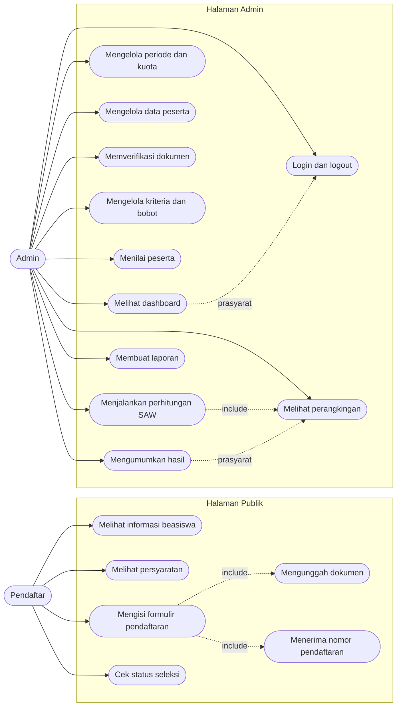
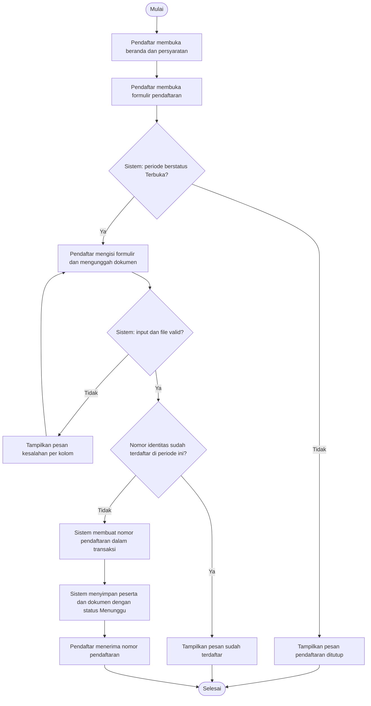
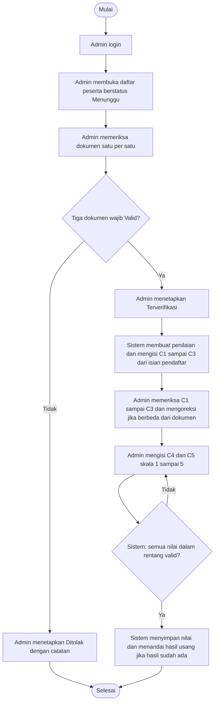
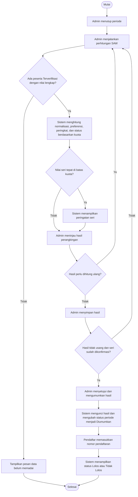
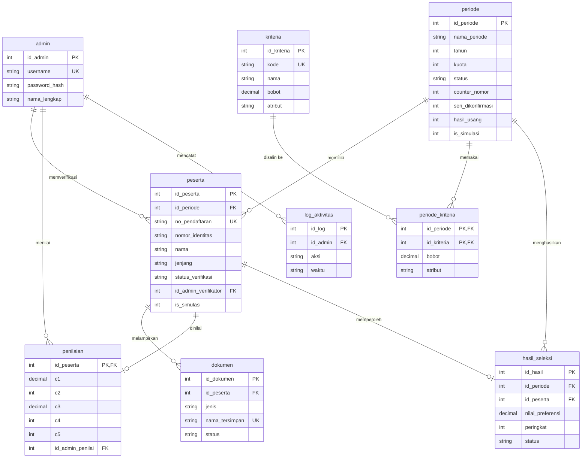
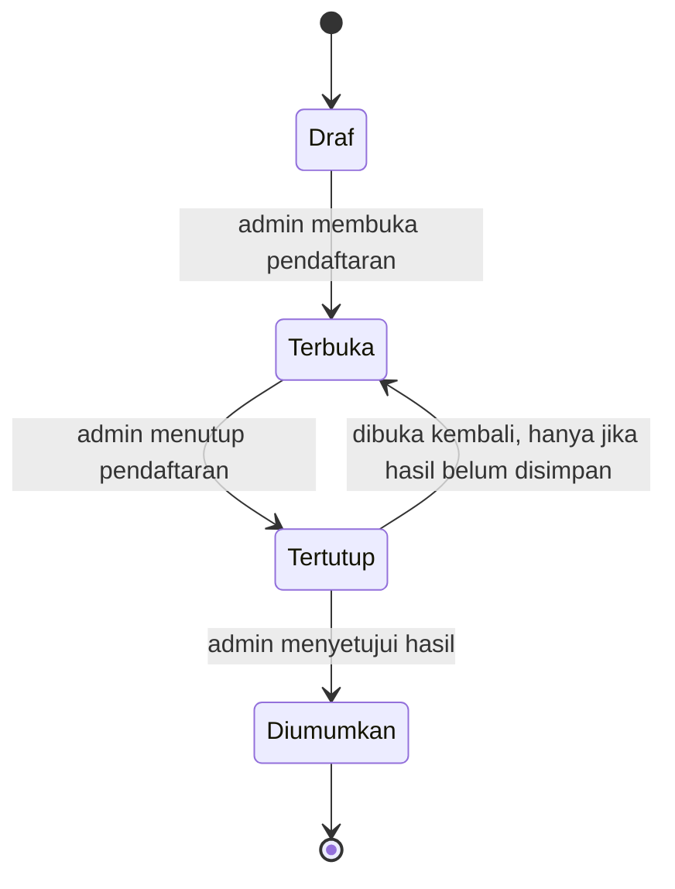
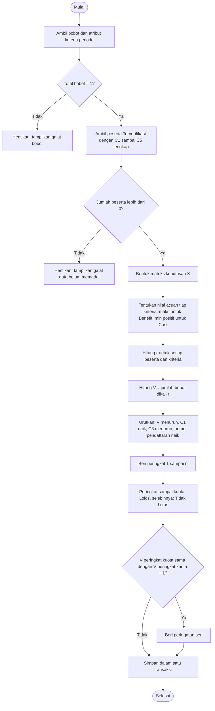

# README TAHAP 2 - PERANCANGAN SISTEM

**Proyek:** SPK Seleksi Penerima Beasiswa Metode SAW Berbasis Web (SDLC Waterfall)
**Tahap:** 2 dari 9
**Jenis pekerjaan:** Perancangan (diagram dan dokumen). Tidak ada perubahan kode aplikasi maupun database.

---

## 1. Tujuan Tahap

Membuat rancangan sistem yang lengkap sebelum implementasi, termasuk menetapkan keputusan yang sengaja ditunda dari Tahap 1 (penghasilan nol, nilai seri, dan lainnya) agar kode perhitungan tidak dibuat sebelum aturannya jelas.

## 2. Ruang Lingkup

1. Use Case Diagram.
2. Activity Diagram.
3. Entity Relationship Diagram (ERD).
4. Struktur database.
5. Alur metode SAW.
6. Rancangan halaman publik.
7. Rancangan halaman admin.

Di luar ruang lingkup: pembuatan tabel dan data di MySQL (Tahap 3) dan penulisan kode (Tahap 4 sampai 7).

## 3. Persiapan

- Hasil Tahap 1: kebutuhan FP/FA/FS, aturan bisnis A1-A6 dan B1-B8.
- Temuan audit Tahap 0, terutama kondisi tabel beasiswa lama di database dan draf `metode.php` lokal.
- Persetujuan pengembang atas keputusan desain D1-D8 (bagian 4).

## 4. Keputusan Desain

Delapan keputusan berikut disetujui pengembang. Keputusan D3 (faktor ×25) dibahas khusus di bagian 4.1.

| ID | Topik | Keputusan |
|---|---|---|
| D1 | Penghasilan nol (C1, Cost) | Jika x = 0 maka r = 1. Nilai `min` dihitung hanya dari penghasilan yang lebih dari 0. Jika semua peserta berpenghasilan 0, semua r = 1. Konsekuensi yang disadari: peserta berpenghasilan 0 dan peserta dengan penghasilan terendah di atas 0 sama-sama memperoleh r = 1 |
| D2 | Nilai seri | Urutan: V menurun (dibandingkan sampai 6 desimal), lalu C1 terendah, lalu C3 tertinggi, lalu nomor pendaftaran terawal. Jika nilai V sama tepat di batas kuota, sistem memberi peringatan dan admin wajib mengonfirmasi sebelum mengumumkan |
| D3 | Konversi IPK (D3/S1) | IPK skala 4 dikalikan **25** (bukan 20). Lihat bagian 4.1 |
| D4 | Struktur database | Skema beasiswa dirancang ulang dan dirapikan. Tabel `tbl_*` lama dihapus di Tahap 3 hanya setelah backup dan persetujuan pengembang. Lima kriteria (C1-C5) tetap; yang dapat diubah hanya bobot dan nama |
| D5 | Status periode | Draf, Terbuka, Tertutup, Diumumkan (lihat bagian 8) |
| D6 | Nomor pendaftaran | Format `BSW-TAHUN-NNN` per periode, dibuat dalam transaksi dengan penghitung di tabel `periode` agar tidak duplikat |
| D7 | Penyimpanan dokumen | Di luar akses publik, nama file acak, tipe diperiksa dari isi file (bukan hanya ekstensi), hanya admin yang dapat mengunduh |
| D8 | Data simulasi | Kolom `is_simulasi` pada `periode` dan `peserta` |

Tambahan: password admin disimpan dengan `password_hash` (kolom `varchar(255)`).

Rincian yang diputuskan selama perancangan (turunan dari keputusan di atas, tanpa mengubah ketentuan Tahap 1):

| ID | Rincian |
|---|---|
| R1 | Bobot dan atribut kriteria disalin ke tabel `periode_kriteria` saat periode dibuat dan hanya dapat diubah selama periode berstatus Draf. Tujuannya agar hasil periode yang sudah diumumkan tetap dapat dihitung ulang dengan bobot yang sama |
| R2 | Paling banyak satu periode berstatus Terbuka pada satu waktu, sehingga "periode aktif" di beranda tidak ambigu |
| R3 | Peserta hanya dapat ditetapkan Terverifikasi jika tiga dokumen wajib (Kartu Keluarga, Penghasilan, Akademik) berstatus Valid |
| R4 | Nilai C1-C3 pada tabel `penilaian` otomatis terisi dari isian pendaftar saat peserta diverifikasi; admin dapat mengoreksinya (A4). C4 dan C5 kosong sampai admin menilai, dan peserta dengan nilai kosong tidak diikutkan perhitungan (B2) |
| R5 | Jika setelah hasil disimpan terjadi perubahan pada status verifikasi, nilai C1-C5, bobot, atau kuota, hasil ditandai usang (`hasil_usang = 1`) dan wajib dihitung ulang sebelum diumumkan |
| R6 | Skala nilai akademik mengikuti jenjang: SMA/SMK memakai rapor 0-100, D3/S1 memakai IPK 0-4,00 |
| R7 | Satu berkas per jenis dokumen (bukti prestasi yang lebih dari satu digabung menjadi satu PDF) |
| R8 | Cek status dibatasi percobaannya (rate limiting) dan memberi pesan seragam jika nomor tidak ditemukan |

### 4.1 Catatan D3: Konversi IPK

README-PROJECT semula menyebut IPK dikalikan 20 (maksimum 80). Karena menurut A6 semua jenjang bersaing dalam satu peringkat dan nilai rapor SMA/SMK berskala sampai 100, faktor 20 merugikan mahasiswa D3/S1 secara sistematis.

| IPK | ×20 | ×25 |
|---|---:|---:|
| 4,00 | 80 | 100 |
| 3,80 | 76 | 95 |
| 3,00 | 60 | 75 |
| 2,00 | 40 | 50 |

Diputuskan **×25** agar IPK 4,00 setara nilai rapor 100. Teks pada README-PROJECT (bagian 5.1) dan Tahap 1 (FS-04) diperbarui. Faktor ini disimpan sebagai konstanta tunggal sehingga mudah diubah jika pengembang atau pembimbing menghendaki ×20.

## 5. Use Case Diagram



Semua use case admin mensyaratkan login (M1).

## 6. Activity Diagram

### 6.1 Pendaftaran



### 6.2 Verifikasi dan Penilaian



### 6.3 Seleksi dan Pengumuman



## 7. Entity Relationship Diagram



Diagram hanya menampilkan kolom kunci dan kolom penting; daftar kolom lengkap ada di bagian 9.

## 8. Status Periode



| Status | Pendaftaran publik | Verifikasi dan penilaian | Hitung SAW | Ubah bobot dan kuota | Hasil terlihat publik |
|---|---|---|---|---|---|
| Draf | Tidak | Tidak | Tidak | Ya (bobot dan kuota) | Tidak |
| Terbuka | Ya | Ya | Tidak | Kuota saja | Tidak |
| Tertutup | Tidak | Ya | Ya | Kuota saja (hasil ditandai usang) | Tidak |
| Diumumkan | Tidak | Terkunci | Terkunci | Terkunci | Ya (status Lolos/Tidak Lolos) |

Syarat Tertutup menjadi Diumumkan: hasil sudah disimpan, `hasil_usang = 0`, dan jika ada seri di batas kuota maka `seri_dikonfirmasi = 1`.

## 9. Rancangan Struktur Database

Skrip pembuatan tabel (DDL) disusun dan dijalankan di Tahap 3. Berikut rancangan kolom dan batasan. Jenis data memakai MySQL 8.4.

### 9.1 `admin` (pengganti `tbl_akun`)

| Kolom | Tipe | Batasan |
|---|---|---|
| id_admin | INT AUTO_INCREMENT | PK |
| username | VARCHAR(50) | UNIQUE, NOT NULL |
| password_hash | VARCHAR(255) | NOT NULL |
| nama_lengkap | VARCHAR(100) | NOT NULL |
| dibuat_pada | TIMESTAMP | default saat dibuat |
| login_terakhir | TIMESTAMP | NULL |

### 9.2 `periode`

| Kolom | Tipe | Batasan |
|---|---|---|
| id_periode | INT AUTO_INCREMENT | PK |
| nama_periode | VARCHAR(100) | NOT NULL |
| tahun | SMALLINT | NOT NULL |
| tanggal_buka, tanggal_tutup | DATE | NULL |
| kuota | INT | NOT NULL, CHECK >= 0 |
| status | ENUM('Draf','Terbuka','Tertutup','Diumumkan') | NOT NULL, default Draf |
| counter_nomor | INT | NOT NULL, default 0 |
| seri_dikonfirmasi | TINYINT(1) | NOT NULL, default 0 |
| hasil_usang | TINYINT(1) | NOT NULL, default 0 |
| tanggal_diumumkan | DATETIME | NULL |
| is_simulasi | TINYINT(1) | NOT NULL, default 1 |

### 9.3 `kriteria` dan `periode_kriteria`

| Tabel | Kolom | Tipe | Batasan |
|---|---|---|---|
| kriteria | id_kriteria | INT AUTO_INCREMENT | PK |
| | kode | VARCHAR(5) | UNIQUE, NOT NULL |
| | nama | VARCHAR(100) | NOT NULL |
| | bobot | DECIMAL(5,4) | NOT NULL (nilai bawaan) |
| | atribut | ENUM('Cost','Benefit') | NOT NULL |
| periode_kriteria | id_periode | INT | PK gabungan, FK ke periode (ON DELETE CASCADE) |
| | id_kriteria | INT | PK gabungan, FK ke kriteria (ON DELETE RESTRICT) |
| | bobot | DECIMAL(5,4) | NOT NULL, CHECK > 0 dan <= 1 |
| | atribut | ENUM('Cost','Benefit') | NOT NULL |

Total bobot per periode harus 1,0000 (B7). MySQL tidak dapat memeriksa jumlah antarbaris, sehingga validasinya dilakukan di aplikasi saat menyimpan dan sebelum SAW dijalankan.

### 9.4 `peserta`

| Kolom | Tipe | Batasan |
|---|---|---|
| id_peserta | INT AUTO_INCREMENT | PK |
| id_periode | INT | FK ke periode (ON DELETE RESTRICT), NOT NULL |
| no_pendaftaran | VARCHAR(30) | UNIQUE, NOT NULL |
| nomor_identitas | VARCHAR(20) | NOT NULL |
| nama | VARCHAR(100) | NOT NULL |
| jenjang | ENUM('SMA','SMK','D3','S1') | NOT NULL |
| asal_institusi | VARCHAR(100) | NOT NULL |
| no_hp | VARCHAR(20) | NOT NULL |
| email | VARCHAR(100) | NULL |
| penghasilan_input | DECIMAL(15,2) | NOT NULL, CHECK >= 0 |
| tanggungan_input | TINYINT UNSIGNED | NOT NULL |
| skala_nilai | ENUM('Rapor100','IPK4') | NOT NULL, harus sesuai jenjang (R6) |
| nilai_akademik_input | DECIMAL(5,2) | NOT NULL, 0-100 (Rapor100) atau 0-4,00 (IPK4) |
| ket_prestasi, ket_organisasi | TEXT | NULL |
| status_verifikasi | ENUM('Menunggu','Terverifikasi','Ditolak') | NOT NULL, default Menunggu |
| catatan_verifikasi | TEXT | NULL |
| id_admin_verifikator | INT | FK ke admin (ON DELETE SET NULL), NULL |
| diverifikasi_pada | DATETIME | NULL |
| tanggal_daftar | TIMESTAMP | default saat dibuat |
| is_simulasi | TINYINT(1) | NOT NULL, default 1 |

Batasan gabungan: `UNIQUE (id_periode, nomor_identitas)` untuk A1. Data pribadi dibatasi pada yang diperlukan seleksi (prinsip minimisasi data).

### 9.5 `dokumen`

| Kolom | Tipe | Batasan |
|---|---|---|
| id_dokumen | INT AUTO_INCREMENT | PK |
| id_peserta | INT | FK ke peserta (ON DELETE CASCADE), NOT NULL |
| jenis | ENUM('KK','Penghasilan','Akademik','Prestasi','Organisasi') | NOT NULL |
| nama_asli | VARCHAR(255) | NOT NULL |
| nama_tersimpan | VARCHAR(64) | UNIQUE, NOT NULL (nama acak) |
| mime_type | VARCHAR(50) | NOT NULL |
| ukuran_byte | INT UNSIGNED | NOT NULL, maksimum 2 MB |
| status | ENUM('Menunggu','Valid','Tidak Valid') | NOT NULL, default Menunggu |
| catatan | VARCHAR(255) | NULL |
| diunggah_pada | TIMESTAMP | default saat dibuat |

Batasan gabungan: `UNIQUE (id_peserta, jenis)` (R7). Dokumen wajib: KK, Penghasilan, Akademik. Opsional: Prestasi, Organisasi.

### 9.6 `penilaian`

| Kolom | Tipe | Batasan |
|---|---|---|
| id_peserta | INT | PK, FK ke peserta (ON DELETE CASCADE) |
| c1 | DECIMAL(15,2) | NULL, CHECK >= 0 (penghasilan) |
| c2 | TINYINT UNSIGNED | NULL (tanggungan) |
| c3 | DECIMAL(5,2) | NULL, CHECK 0-100 (nilai akademik terkonversi) |
| c4 | TINYINT | NULL, CHECK 1-5 |
| c5 | TINYINT | NULL, CHECK 1-5 |
| catatan_koreksi | VARCHAR(255) | NULL |
| id_admin_penilai | INT | FK ke admin (ON DELETE SET NULL), NULL |
| dinilai_pada | DATETIME | NULL |

### 9.7 `hasil_seleksi`

| Kolom | Tipe | Batasan |
|---|---|---|
| id_hasil | INT AUTO_INCREMENT | PK |
| id_periode | INT | FK ke periode (ON DELETE RESTRICT), NOT NULL |
| id_peserta | INT | FK ke peserta (ON DELETE RESTRICT), NOT NULL |
| nilai_preferensi | DECIMAL(10,6) | NOT NULL |
| peringkat | INT | NOT NULL |
| status | ENUM('Lolos','Tidak Lolos') | NOT NULL |
| dihitung_pada | TIMESTAMP | default saat dibuat |

Batasan gabungan: `UNIQUE (id_periode, id_peserta)` dan `UNIQUE (id_periode, peringkat)`. Relasi ke peserta memakai RESTRICT agar peserta yang sudah memiliki hasil tidak terhapus diam-diam.

### 9.8 `log_aktivitas`

| Kolom | Tipe | Batasan |
|---|---|---|
| id_log | INT AUTO_INCREMENT | PK |
| id_admin | INT | FK ke admin (ON DELETE SET NULL), NULL |
| aksi | VARCHAR(50) | NOT NULL |
| keterangan | VARCHAR(255) | NULL |
| waktu | TIMESTAMP | default saat dibuat |

Dicatat: login, ubah status periode, simpan hasil, pengumuman, hapus peserta.

### 9.9 Rencana terhadap Tabel Lama (dieksekusi di Tahap 3)

| Tabel saat ini | Rencana |
|---|---|
| `periode`, `peserta`, `kriteria`, `penilaian`, `hasil_seleksi` (percobaan beasiswa) | Direstrukturisasi menjadi rancangan di atas; data simulasi 5 baris dipertahankan atau diganti dataset 30 peserta |
| `tbl_akun` | Dimigrasikan ke `admin` dengan password di-hash |
| `tbl_alternatif`, `tbl_kriteria`, `tbl_subkriteria`, `tbl_nilai`, `hasil_saw` (santri) | Dihapus setelah backup dan persetujuan pengembang |

## 10. Rancangan Alur Metode SAW

### 10.1 Masukan dan Prasyarat

- Periode berstatus Tertutup.
- Bobot kriteria periode berjumlah tepat 1,0000.
- Himpunan peserta: `status_verifikasi = 'Terverifikasi'` dan C1-C5 tidak kosong (B2, B3).

### 10.2 Diagram Alur



### 10.3 Aturan Perhitungan

| Langkah | Aturan |
|---|---|
| Nilai acuan Benefit | `max(x_j)` dari peserta yang diikutkan |
| Nilai acuan Cost | `min(x_j)` dari nilai yang lebih dari 0; jika tidak ada, acuan 0 |
| Normalisasi Benefit | `r = x / max`; jika `max = 0` maka `r = 0` |
| Normalisasi Cost | `r = min / x`; jika `x = 0` maka `r = 1` (D1) |
| Nilai preferensi | `V = Σ (w_j × r_j)` dengan bobot dari `periode_kriteria` |
| Presisi | Tidak ada pembulatan sebelum hasil akhir; V disimpan 6 desimal dan dibandingkan pada 6 desimal |
| Urutan | V menurun, C1 menaik, C3 menurun, nomor pendaftaran menaik (D2); peringkat selalu berurutan dan unik |
| Status | Peringkat <= kuota: Lolos; selebihnya Tidak Lolos. Kuota 0: tidak ada yang Lolos; kuota >= jumlah peserta: semua Lolos |
| Peringatan seri | Jika `V[kuota] = V[kuota + 1]` pada 6 desimal; penentuan tetap mengikuti aturan urutan, tetapi admin wajib mengonfirmasi |
| Konversi C3 | SMA/SMK: rapor apa adanya; D3/S1: IPK × 25 (keputusan D3 pada bagian 4) |

### 10.4 Catatan terhadap Implementasi Lama

Rancangan ini menyelesaikan kelemahan yang ditemukan pada audit Tahap 0: perhitungan dipisah dari halaman tampilan, tidak ada pembulatan sebelum bobot dikalikan, nilai nol dan seri ditangani, dan status Lolos ditentukan oleh kuota (bukan `ranking <= 1`).

## 11. Rancangan Halaman Publik

### 11.1 Peta Halaman

| Halaman | Berkas rencana | Kebutuhan |
|---|---|---|
| Beranda | `index.php` | FP-01 |
| Persyaratan | `persyaratan.php` | FP-02 |
| Formulir pendaftaran | `daftar.php` | FP-03, FP-04, FP-05, FP-07 |
| Bukti pendaftaran | `bukti.php` | FP-06 (nomor dibawa lewat sesi, bukan URL) |
| Cek status | `status.php` | FP-08 |

Pada proyek saat ini `index.php` adalah halaman login. Pada rancangan baru `index.php` menjadi beranda publik dan login dipindah ke `admin/login.php` (dikerjakan di Tahap 4 dan 5).

### 11.2 Sketsa Antarmuka

Beranda:

```text
+--------------------------------------------------------------+
|  Logo   BEASISWA [nama]            Beranda | Persyaratan |   |
|                                    Daftar  | Cek Status      |
+--------------------------------------------------------------+
|  Seleksi Penerima Beasiswa [Periode aktif]                   |
|  Pendaftaran: [tgl buka] s.d. [tgl tutup]   [ Daftar Sekarang ]|
|  Jenjang: SMA | SMK | D3 | S1                                |
+--------------------------------------------------------------+
|  Kriteria penilaian: C1 Penghasilan ... C5 Keaktifan          |
|  Tidak ada periode terbuka -> tampil "Pendaftaran ditutup"   |
+--------------------------------------------------------------+
```

Formulir pendaftaran:

```text
Data Diri       : Nama | Nomor identitas (NISN/NIM) | Jenjang
Institusi       : Asal sekolah/kampus | No HP | Email (opsional)
Data Seleksi    : Penghasilan keluarga per bulan (Rp)
                  Jumlah tanggungan
                  Nilai rapor 0-100 (SMA/SMK) atau IPK 0-4,00 (D3/S1)
                  Keterangan prestasi | Keterangan organisasi
Dokumen         : Kartu Keluarga*  Penghasilan*  Akademik*
                  Prestasi        Organisasi        (PDF/JPG/PNG, maks 2 MB)
                  [ Kirim Pendaftaran ]      * wajib
```

Cek status:

```text
Nomor pendaftaran: [ BSW-2026-001 ]  [ Periksa ]
Hasil (sebelum diumumkan): Status verifikasi: Menunggu | Terverifikasi | Ditolak
Hasil (setelah diumumkan): LOLOS atau TIDAK LOLOS  (tanpa nilai dan peringkat)
Tidak ditemukan: pesan seragam; percobaan dibatasi
```

## 12. Rancangan Halaman Admin

### 12.1 Peta Halaman

| Halaman | Berkas rencana | Kebutuhan |
|---|---|---|
| Login | `admin/login.php` | FA-01 |
| Dashboard | `admin/index.php` | FA-02 |
| Periode dan kuota | `admin/periode.php` | FA-03 |
| Daftar peserta | `admin/peserta.php` | FA-04 |
| Detail peserta (verifikasi dan penilaian) | `admin/peserta_detail.php` | FA-05, FA-07 |
| Kriteria dan bobot | `admin/kriteria.php` | FA-06 |
| Perhitungan SAW | `admin/hitung.php` | FA-08, FA-09, FA-10 |
| Hasil dan pengumuman | `admin/hasil.php` | FA-10, FA-11 |
| Laporan | `admin/laporan.php` | FA-12 |
| Unduh dokumen (terlindungi) | `admin/unduh.php` | FS-05 |
| Logout | `admin/logout.php` | FA-01 |

### 12.2 Sketsa Antarmuka

Menu: Dashboard | Periode | Peserta | Kriteria | Hitung SAW | Hasil | Laporan | Keluar.

Detail peserta:

```text
[BSW-2026-001] Nama | Jenjang | Status: Menunggu
Dokumen   : KK [Lihat] [Valid|Tidak Valid]   Penghasilan [...]  Akademik [...]
            Catatan: [__________]
Verifikasi: [ Terverifikasi ] [ Ditolak ]   (aktif jika 3 dokumen wajib Valid)
Penilaian : C1 [ ] C2 [ ] C3 [ ]  (terisi dari pendaftar, dapat dikoreksi)
            C4 Prestasi [1-5]  C5 Keaktifan [1-5]   [ Simpan ]
```

Hasil dan pengumuman:

```text
Periode: [pilih]  Status: Tertutup   Kuota: 3   Hasil: [tersimpan / usang]
Peringatan: nilai seri di batas kuota -> [ ] Saya sudah meninjau
+-----+--------------+------------+----------+-----------+
| No  | No. Daftar   | Nama       | V        | Status    |
+-----+--------------+------------+----------+-----------+
[ Hitung Ulang ]  [ Simpan Hasil ]  [ Umumkan ] (aktif jika syarat bagian 8 terpenuhi)
```

### 12.3 Rancangan Struktur Proyek (dilaksanakan bertahap di Tahap 3-5)

```text
index.php  persyaratan.php  daftar.php  bukti.php  status.php
admin/     login.php  index.php  periode.php  peserta.php  peserta_detail.php
           kriteria.php  hitung.php  hasil.php  laporan.php  unduh.php  logout.php
includes/  koneksi.php  auth.php  csrf.php  helper.php  saw.php
storage/   dokumen/   (dengan .htaccess penolak akses langsung)
```

Struktur kode saat ini belum diubah pada tahap ini.

## 13. Keterlacakan Kebutuhan ke Rancangan

| Kebutuhan | Rancangan |
|---|---|
| FP-01, FP-02 | Halaman Beranda dan Persyaratan (11.1) |
| FP-03, FP-04 | Formulir (11.2), tabel `peserta` (9.4), aktivitas 6.1 |
| FP-05 | Tabel `dokumen` (9.5), D7, R7 |
| FP-06 | D6, kolom `counter_nomor`, aktivitas 6.1 |
| FP-07 | Status periode (bagian 8), R2 |
| FP-08 | Halaman Cek Status, R8, bagian 8 |
| FA-01 | `admin`, `login.php`, hash password, use case M1 |
| FA-02 | `admin/index.php` |
| FA-03 | `periode`, bagian 8 |
| FA-04 | `peserta.php`, relasi `peserta` ke `periode` |
| FA-05 | `dokumen.status`, R3, aktivitas 6.2 |
| FA-06 | `kriteria`, `periode_kriteria`, R1 |
| FA-07 | `penilaian`, R4, aktivitas 6.2 |
| FA-08, FA-09 | Bagian 10 |
| FA-10 | Bagian 10.3 (D1, D2), `hasil_seleksi` |
| FA-11 | Bagian 8, R5, aktivitas 6.3 |
| FA-12 | `laporan.php` |
| FS-01 | D6 dan `UNIQUE no_pendaftaran` |
| FS-02 | D8 |
| FS-03, FS-04 | Bagian 10.3, D3 |
| FS-05 | D7, `unduh.php`, `storage/` |

Seluruh 8 kebutuhan publik, 12 kebutuhan admin, dan 5 kebutuhan sistem dari Tahap 1 memiliki rancangan.

## 14. File yang Dibuat atau Diubah

| File | Aksi |
|---|---|
| `docs/README-Tahap-02-Perancangan.md` | Dibuat (dokumen ini, berisi seluruh diagram dan rancangan) |
| `README-PROJECT.md` | Status Tahap 2 menjadi Selesai; teks konversi IPK (bagian 5.1) diperbarui dari ×20 menjadi ×25 |
| `docs/README-Tahap-01-Analisis.md` | FS-04 diperbarui dari ×20 menjadi ×25 |
| Kode aplikasi dan database | Tidak diubah |

## 15. Prosedur dan Hasil Pengujian

Pengujian rancangan dilakukan dengan menjalankan skrip uji terhadap rancangan SAW dan rancangan relasi database, serta pemeriksaan silang dokumen.

### 15.1 Pengujian Rancangan SAW

Rancangan diimplementasikan dua kali: sebagai referensi memakai pecahan eksak (tanpa galat floating point) dan sebagai versi `float` yang meniru cara PHP. Data contoh (bukan data nyata) mencakup penghasilan 0 dan dua peserta kembar.

| No | Pengujian | Hasil |
|---|---|---|
| 1 | Versi float sama dengan referensi eksak | Lolos (selisih maksimum 1,1 × 10^-16) |
| 2 | Total bobot = 1; semua r dan V berada di rentang 0 sampai 1 | Lolos |
| 3 | Penghasilan 0 memberi r = 1, dan nilai min diambil dari penghasilan lebih dari 0 | Lolos |
| 4 | Peringkat berurutan dan unik; status sesuai kuota 0, 1, 2, 3, 4, 6, 9 | Lolos |
| 5 | Peringatan seri muncul pada kuota 1 (dua peserta kembar di batas) dan tidak muncul pada kuota lain | Lolos |
| 6 | Data kembar terurut oleh aturan terakhir (nomor pendaftaran) | Lolos |
| 7 | Semua penghasilan 0: semua r = 1 | Lolos |
| 8 | 2.000 skenario acak (1-30 peserta, kuota acak): V di rentang 0-1, float = eksak, peringkat unik | Lolos |
| 9 | Konversi IPK ×25 menghasilkan IPK 4,00 = 100 | Lolos |

### 15.2 Pengujian Relasi dan Batasan Database

Rancangan batasan diuji pada SQLite 3.45 dengan `FOREIGN KEY` aktif. Pengujian ini hanya memeriksa logika relasi dan batasan; kompatibilitas sintaks MySQL 8.4 diuji saat tabel dibuat di Tahap 3.

| Pengujian | Hasil |
|---|---|
| Nomor identitas sama pada periode sama ditolak (A1) | Lolos |
| Nomor identitas sama pada periode berbeda diterima | Lolos |
| Nomor pendaftaran duplikat ditolak (FS-01) | Lolos |
| Peserta dengan periode tidak ada ditolak (FK) | Lolos |
| Jenjang dan status di luar daftar ENUM ditolak | Lolos |
| C4 di luar 1-5 dan C3 di atas 100 ditolak | Lolos |
| Satu penilaian per peserta; satu dokumen per jenis (R7) | Lolos |
| Hasil ganda per periode dan peserta ditolak | Lolos |
| Menghapus peserta yang sudah memiliki hasil ditolak (RESTRICT) | Lolos |
| Menghapus peserta tanpa hasil menghapus dokumen dan penilaiannya (CASCADE) | Lolos |
| Menghapus periode yang masih memiliki peserta ditolak | Lolos |
| Menghapus periode menghapus `periode_kriteria` (CASCADE) | Lolos |
| Penghitung nomor periode menghasilkan `BSW-2027-001` | Lolos |

Total: 20 dari 20 pemeriksaan lolos.

### 15.3 Pemeriksaan Alur Proses dan Kesesuaian

| Pemeriksaan | Hasil |
|---|---|
| Lima alur Tahap 1 (9.1 sampai 9.5) tercakup oleh aktivitas 6.1 sampai 6.3 | Sesuai |
| Setiap transisi status periode (bagian 8) memiliki aktivitas yang memicunya | Sesuai |
| Semua kebutuhan FP, FA, FS memiliki rancangan (bagian 13) | Sesuai (25 dari 25) |
| Setiap use case admin dan publik memiliki halaman rancangan | Sesuai |
| Aturan bisnis A1-A6 dan B1-B8 tercermin pada rancangan (batasan, status, alur) | Sesuai |
| Delapan keputusan yang ditunda dari Tahap 1 sudah ditetapkan | Sesuai |
| Sintaks seluruh diagram Mermaid diperiksa dengan Mermaid CLI | Lihat catatan di bawah |

Catatan validasi diagram: ketujuh diagram (use case, tiga activity diagram, ERD, status periode, alur SAW) berhasil dirender oleh Mermaid CLI tanpa galat sintaks. Use case diagram dan ERD juga diperiksa secara visual dan terbaca. Mermaid ditampilkan langsung oleh GitHub, sehingga diagram tampil sebagai gambar pada halaman file.

## 16. Kendala dan Solusi

| Kendala | Solusi |
|---|---|
| Faktor konversi IPK ×20 pada README-PROJECT membuat IPK maksimum hanya 80 sehingga merugikan D3/S1 | Diusulkan ×25 dan disetujui pengembang; faktor disimpan sebagai konstanta tunggal |
| MySQL tidak dapat membatasi jumlah bobot antarbaris | Validasi dilakukan di aplikasi dan diperiksa lagi sebelum SAW dijalankan |
| Hasil lama dapat tidak sinkron jika data berubah setelah dihitung | Penanda `hasil_usang` dan syarat pengumuman (R5) |
| Perubahan bobot setelah pengumuman dapat mengubah hasil yang dihitung ulang | Bobot disalin per periode dan dikunci (R1) |
| Nomor pendaftaran berurutan memungkinkan penebakan nomor | Pembatasan percobaan dan pesan seragam (R8); lihat bagian 17 |

## 17. Risiko dan Keputusan untuk Tahap Berikutnya

| Topik | Catatan | Tahap |
|---|---|---|
| Penebakan nomor pendaftaran | Format `BSW-TAHUN-NNN` berurutan sehingga nomor orang lain dapat ditebak. Halaman publik hanya menampilkan status, dan percobaan dibatasi. Jika pengembang ingin lebih aman, dapat ditambahkan akhiran acak pada nomor | 4 |
| Mahasiswa baru tanpa IPK | Belum ada aturan; sementara memakai rapor SMA/SMK sebagai nilai akademik atau ditangani di luar sistem | 4 |
| Skrip pembuatan tabel dan dataset 30 peserta | Disusun dengan komposisi SMA 10, SMK 10, D3 5, S1 5, termasuk kasus penghasilan 0 dan nilai seri | 3 |
| Hapus tabel `tbl_*` lama | Hanya setelah backup baru dan persetujuan pengembang | 3 |
| Perubahan struktur folder dan pemindahan login | Dilakukan bertahap bersama implementasi halaman | 4-5 |

## 18. Status Penyelesaian

| Kegiatan | Status |
|---|---|
| Use Case Diagram | Selesai |
| Activity Diagram (3 diagram) | Selesai |
| ERD | Selesai |
| Rancangan struktur database | Selesai |
| Rancangan alur SAW | Selesai, diuji |
| Rancangan halaman publik dan admin | Selesai |
| Pengujian rancangan | Selesai, semua lolos |
| README Tahap 2 | Selesai |
| Commit dan push ke GitHub | Dikerjakan pengembang (bagian 19) |
| Verifikasi di GitHub, termasuk diagram tampil | Setelah push |

**Tahap 2 dinyatakan selesai setelah push berhasil, file terlihat di GitHub, dan diagram tampil sebagai gambar (bukan teks mentah).**

## 19. Informasi Commit Git

```powershell
git add README-PROJECT.md docs/README-Tahap-01-Analisis.md docs/README-Tahap-02-Perancangan.md
git commit -m "Tahap 2: perancangan sistem"
git push
```

| Item | Nilai |
|---|---|
| Pesan commit | `Tahap 2: perancangan sistem` |
| Repository | `muftiabunaseh0924/spk-beasiswa-saw` (Private) |
| Branch | `main` |
| Hash commit | Lihat dengan `git log --oneline -1` |
